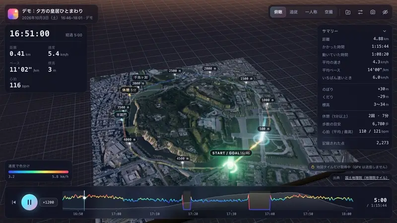
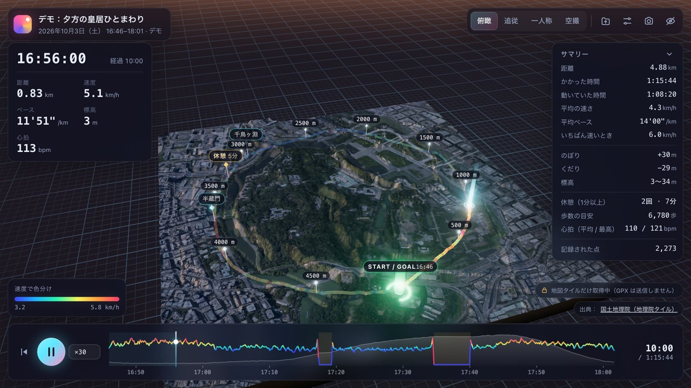
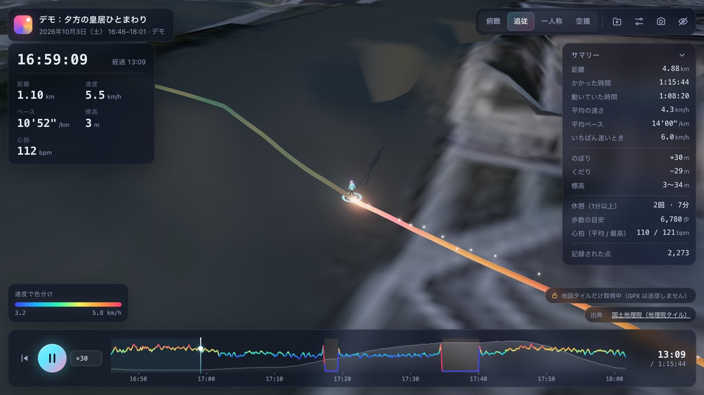
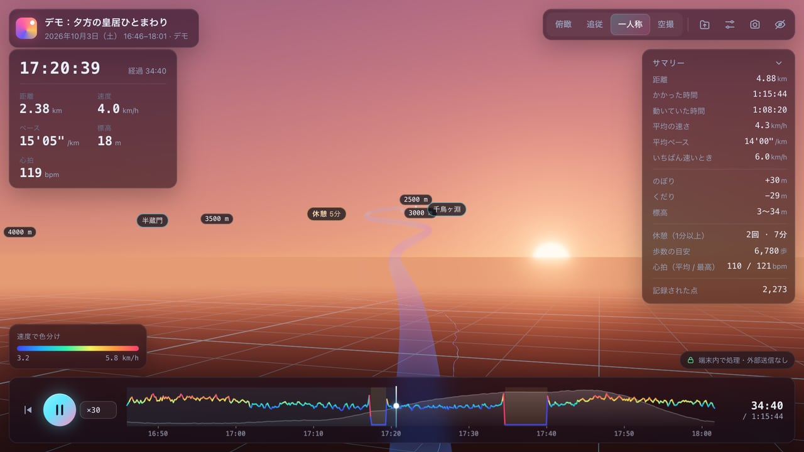
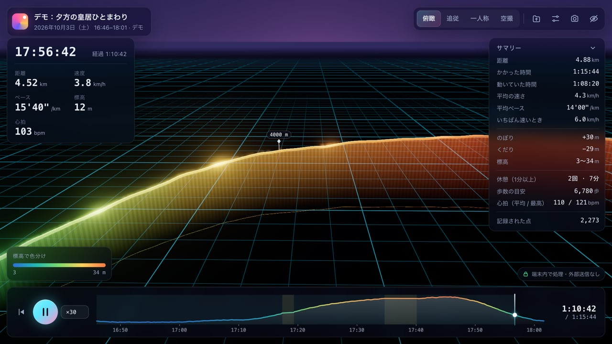
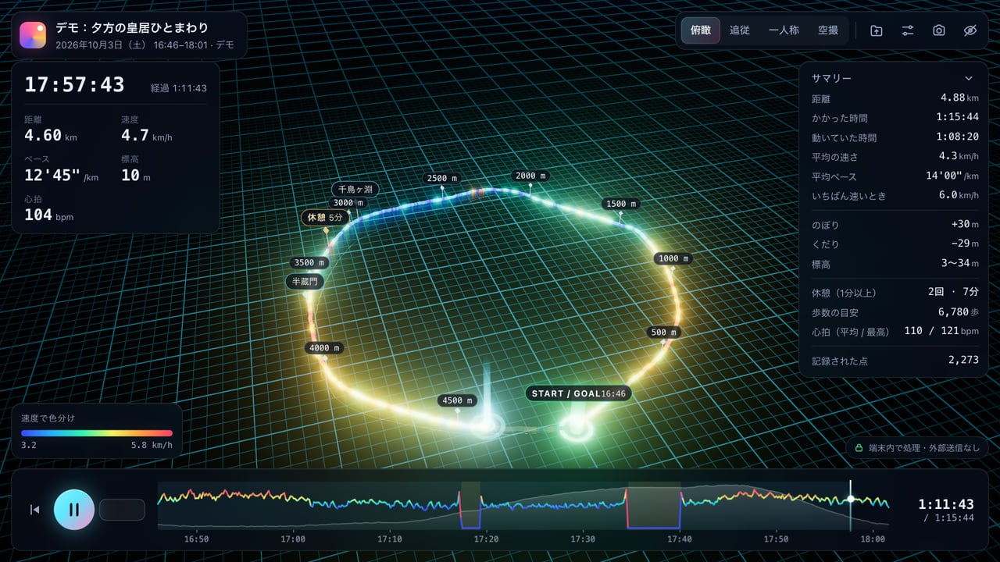
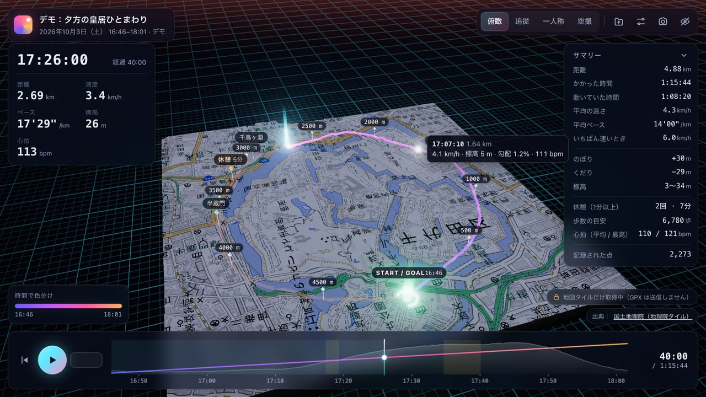

# Trailscape（トレイルスケープ）

GPX ログを 3D のジオラマにして、記録した時刻どおりにもう一度歩けるブラウザアプリ。

[](https://tanuu5.github.io/trailscape/)
[](https://www.anthropic.com/claude)
[](./LICENSE)

<p align="center">
  
</p>

<p align="center"><b><a href="https://tanuu5.github.io/trailscape/">▶ ブラウザで開く</a></b>（インストール不要。「デモを見る」ですぐ試せます）</p>

**Claude Code × Claude Opus 5.5（XHIGH）** で作りました。

散歩やランニング、サイクリングの GPX ファイルを読み込むと、通った道が光るチューブになって立ち上がり、小さな人が記録どおりの時刻で歩き直します。
記録した日時と場所から太陽の位置を計算するので、夕方の散歩なら再生の途中で日が沈みます。
ファイルはブラウザの中だけで処理し、どこにも送信しません。地図と地形（国土地理院の地理院タイル）は、設定でオンにしたときだけ取得します。

## スクリーンショット

<table>
  <tr>
    <td width="50%"><br><sub>地理院タイルをオンにすると、道のまわりが台座つきのジオラマに。お堀と石垣も立体になります。</sub></td>
    <td width="50%"><br><sub>追従カメラ。小さな人が、記録した速さに合わせて手足を振って歩きます。</sub></td>
  </tr>
  <tr>
    <td><br><sub>一人称。記録した時刻の太陽の位置で、夕焼けの中を歩きます。</sub></td>
    <td><br><sub>標高で色分け。道の下のカーテンで、半蔵門からの下り坂が見えます。</sub></td>
  </tr>
  <tr>
    <td><br><sub>日が暮れると、方眼の上で光る軌跡に。速さで色分けしています。</sub></td>
    <td><br><sub>淡色地図。道にマウスを乗せると、その地点の時刻・速さ・標高・心拍が出ます。</sub></td>
  </tr>
</table>

画像と動画は、すべて実際の画面です。写っているのはアプリに入っているデモのログで、皇居のまわりを夕方に一周する想定でプログラムが合成した架空の記録です。

## できること

- **光る軌跡**：速度・標高・時間・勾配・心拍で色分けしたチューブと、標高を示す半透明のカーテン
- **再生**：記録した時刻どおりに小さな人が道を歩きます。速さは ×1〜×3000、休憩中は早送り
- **カメラ 4 種**：俯瞰 / 追従 / 一人称 / 空撮（歩く人のまわりをぐるっと回る）
- **その時刻の空**：記録時刻と場所から太陽の位置を計算し、空の色・光の向き・影を変えます。夜は星が出ます
- **タイムライン**：標高の面グラフに色分け中の値を重ねて表示。クリックやドラッグでその時刻へ移動
- **目印**：スタート / ゴール、距離ごとの目印、2 分以上の休憩、GPX のウェイポイント
- **サマリー**：距離、かかった時間、動いていた時間、平均・最高の速さ、のぼり / くだり、休憩、歩数の目安、心拍
- **地形（任意）**：地理院タイル（航空写真・標準地図・淡色地図・色別標高図と、5 m / 10 m の標高）から、道のまわりをジオラマにします
- **画像の保存**：今の画面を PNG で保存

## 使い方

GPX ファイルを画面にドロップするか、「ファイルを選ぶ」で開きます。「デモを見る」で、上の画像と同じデモのログを再生できます。

| キー | 動作 |
| --- | --- |
| `Space` | 再生 / 一時停止 |
| `←` `→` | 少し戻る / 進む（`Shift` で大きく） |
| `[` `]` | 再生速度 |
| `1`〜`4` | 俯瞰 / 追従 / 一人称 / 空撮 |
| `H` | UI を隠す |
| `P` | 画像を保存 |
| `O` | ファイルを開く |
| `L` | ラベルの表示切り替え |

- 道をクリックすると、その地点へ移動します。一人称ではドラッグで見回せます。
- 右上の設定ボタンで、色分け、高さの強調、線の太さ、空（記録時刻 / 昼 / 夕暮れ / 夜）、地図と地形を切り替えられます。
- 地図がオフのまま GPX を開くと、設定からオンにできることを案内します（その場でオンにするボタンつき）。

### 読める GPX

- `trk` / `trkseg` / `trkpt`（なければ `rte` / `rtept`）と `wpt`
- 位置、標高（`ele`）、時刻（`time`）、心拍（`gpxtpx:hr` など。名前空間の接頭辞は問いません）
- 時刻や標高がない GPX も読めます。そのときは、使える表示だけになります

## プライバシー

- GPX ファイルはブラウザの `DOMParser` で読み、外部には送りません。
- 外部と通信するのは、設定で「地理院タイルで地形を作る」をオンにしたときだけです。送るのはタイル（地図画像）の要求だけで GPX は送りませんが、取得するタイルの位置から、おおよその場所は国土地理院のサーバーに伝わります。
- ビルドした HTML には Content-Security-Policy を入れてあり、通信先を地理院タイル（`cyberjapandata.gsi.go.jp`）だけに制限しています。
- 設定と「前回のファイル」は、使っているブラウザの localStorage にだけ保存します。

## 制作について

企画・ディレクション：**たぬ**　／　開発：**Claude Code（Claude Opus 5.5・推論レベル XHIGH）**

設計から実装・動作確認まで、Claude Code が進めました。描画は three.js（WebGL）で、カメラ 4 種・地形・夜の表示・スマホ幅を Mac の実 GPU で画面を見ながら確かめ、時刻なし・標高なし・ルートだけ・6 万点の GPX も合成して読み込みを確かめています。
README の画像と動画は、ヘッドレス Chrome と仮想時計で、実際の画面を 1 コマずつ撮影しました。

## 更新履歴

- **2026-10-03**：公開

## 開発

```bash
npm install
npm run dev      # http://localhost:5173
npm run build    # dist/index.html（1 枚の HTML）に出力
npm run preview  # ビルド結果の確認
```

`dist/index.html` は JavaScript と CSS をすべて含む 1 枚の HTML です。サーバーなしで、ダブルクリックで開いても動きます。

```
src/
  main.js          画面の操作・再生・設定・ファイルの読み込み
  gpx.js           GPX の読み取り
  track.js         停止の検出、距離・速度・休憩・獲得標高、描画用の等間隔サンプリング
  geo.js           座標の変換、タイル座標、太陽の位置
  demo.js          デモのログ（皇居ひとまわり）の合成
  scene/
    viewer.js      シーン全体、カメラ 4 種、空と光、ブルーム
    trail.js       光るチューブとカーテン（シェーダ）
    walker.js      歩く人
    terrain.js     地理院タイルからの地形ジオラマ
    sky.js / ground.js / markers.js / effects.js
  ui/timeline.js   タイムラインのグラフ
docs/screenshots/  README の画像と動画
```

## GitHub Pages で公開する

1. このフォルダを GitHub リポジトリとして push します（ブランチ `main`）。
2. リポジトリの **Settings → Pages → Build and deployment → Source** を **GitHub Actions** にします。
3. `main` に push するたびに `.github/workflows/deploy.yml` がビルドして公開します。

`vite.config.js` の `base: './'` により、`https://<ユーザー名>.github.io/<リポジトリ名>/` のようなサブパスでもそのまま動きます。公開したページでも、GPX は見ている人のブラウザの中だけで処理されます。

## クレジット・ライセンス

- コード：MIT License（[LICENSE](LICENSE)）© 2026 たぬ
- 3D 描画：[three.js](https://threejs.org/)（MIT License）。ビルドした HTML に同梱しています
- ビルド：[Vite](https://vite.dev/)、[vite-plugin-singlefile](https://github.com/richardtallent/vite-plugin-singlefile)（どちらも MIT License）
- 地図・標高：[地理院タイル](https://maps.gsi.go.jp/development/ichiran.html)（出典：国土地理院）。リポジトリには含めず、オンにしたときにブラウザが取得します
- フォントは OS に入っているものを使い、外部から読み込みません
- MIT License の対象はこのリポジトリのコードと文章です。「Claude」の名前や商標の使用を許諾するものではありません。
